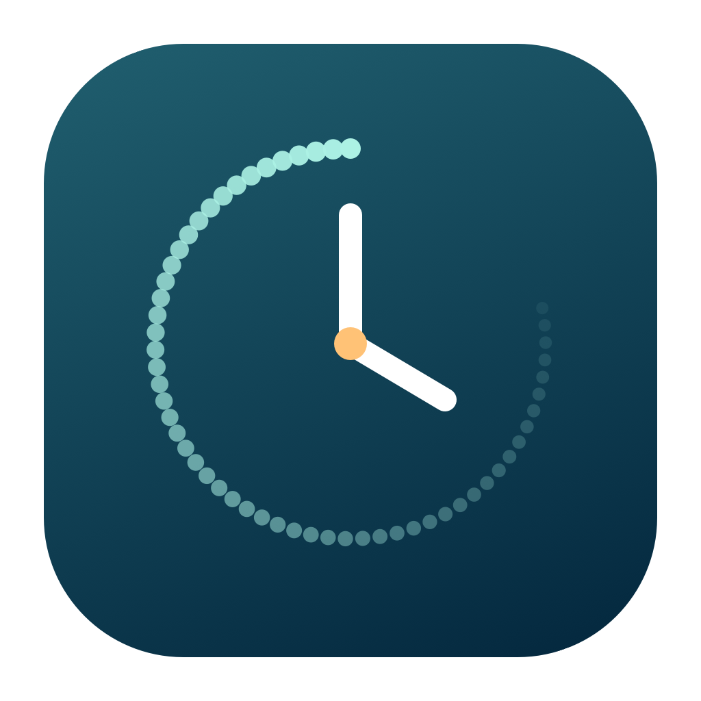
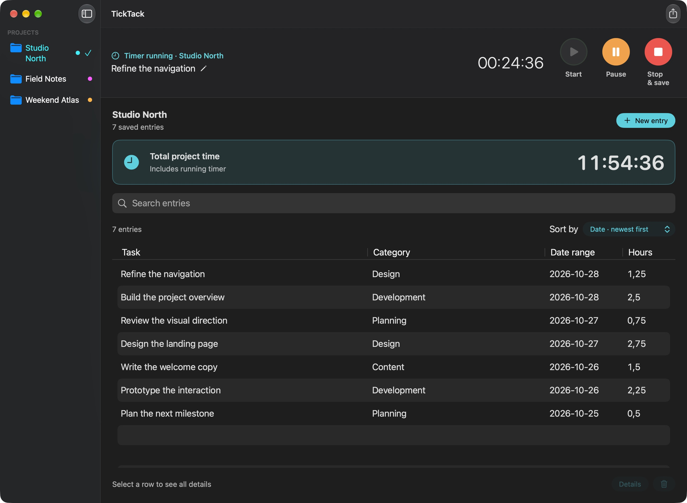
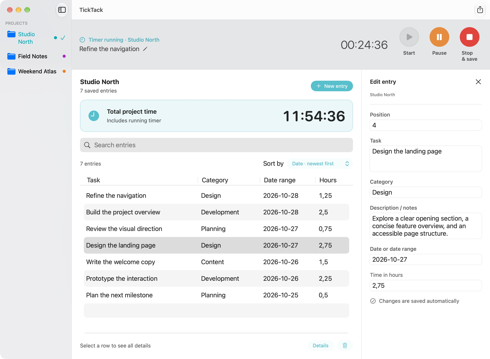
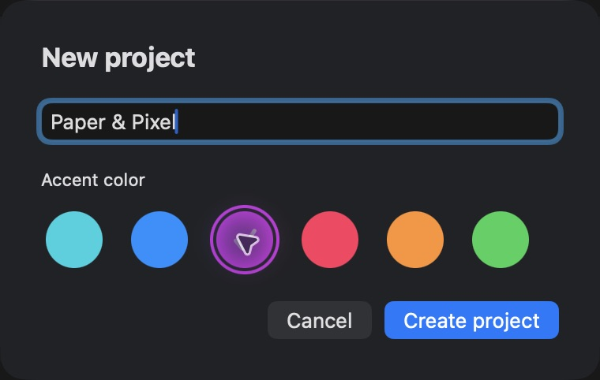

<p align="center">
  
</p>
<h1 align="center">TickTack</h1>
<p align="center"><strong>A little more clarity about where your time goes.</strong></p>
<p align="center">A native Mac app for project time tracking.<br>Start a timer, get on with your work, and keep the details in one place.</p>
<p align="center">
  <a href="https://github.com/Aluhut/TickTack/releases/latest">Download TickTack</a> ·
  <a href="docs/README.de.md">Deutsch</a> ·
  <a href="docs/USER_GUIDE.md">User guide</a>
</p>
<p align="center">macOS 14+ &nbsp; · &nbsp; Apple silicon & Intel &nbsp; · &nbsp; English & Deutsch &nbsp; · &nbsp; MIT</p>


<p align="center"><sub>Your projects, a clear list of entries, and the current total. All screenshots use fictional demo data.</sub></p>

## Less bookkeeping. More room for the work.

TickTack keeps time tracking close at hand: a timer in the menu bar, an overview when you need it, and editable details for everything you have done. No account to create. No subscription. Your data stays on your Mac.

### Start. Pause. Carry on.

Large, labelled controls make the next action easy to find. Pause for a break, resume when you are ready, and stop to save. The project total includes your current measurement, so the number you see stays up to date.

### Give the details some space.

Keep the main list compact and open the inspector when you need the full story. Edit the task, category, notes, date range, or hours. Add time manually when you have already finished the work.


<p align="center"><sub>A focused list on the left. The complete entry on the right.</sub></p>

### A place for every project.

Choose a name and an accent color. Each project has its own entries, total, and CSV export. Search your notes, change the sort order, or remove several entries together. Deleted entries and projects can be restored, even after restarting.


<p align="center"><sub>Six accent colors, readable text, and familiar Mac controls.</sub></p>

## Make yourself at home

- **Readable by default.** A 17-point base font, generous rows, and text sizes adjustable from 16 to 24 points.
- **Two languages.** German when the primary system language is German; English for every other language. Your own text stays as you wrote it.
- **Your preferred order.** Sort by date, task, category, or hours; your choice is remembered.
- **A useful handoff.** Export a project's saved entries as CSV for Numbers, Excel, or a project report.
- **Local storage.** Projects, saved entries, preferences, and restorable deletions stay on your Mac. No analytics or remote service is included.

## Get TickTack

Requires **macOS 14 (Sonoma) or later**.

- **[Download for Apple silicon — M1 and later](https://github.com/Aluhut/TickTack/releases/download/v0.9.0/TickTack-0.9.0-macOS-arm64.zip)**
- **[Download for Intel Macs](https://github.com/Aluhut/TickTack/releases/download/v0.9.0/TickTack-0.9.0-macOS-x86_64.zip)**

Extract the ZIP, drag **TickTack.app** to **Applications**, and open it from there. Checksums are available on the [release page](https://github.com/Aluhut/TickTack/releases/latest).

**First launch blocked by macOS?** These builds are ad-hoc signed and not notarized. Follow the [Gatekeeper guide](docs/FIRST_LAUNCH.md#english) to approve TickTack individually, without disabling Gatekeeper.

### Your first entry

1. Choose **File → New project…** (⌘N), enter a name, and pick a color.
2. Click **New entry** and describe your task.
3. Press **Start**, pause when needed, then **Stop & save**.

For work you have already done, enter decimal hours and choose **Add entry**. For example, 1.5 hours is 90 minutes. The [user guide](docs/USER_GUIDE.md) covers editing, selecting multiple rows, restoring deletions, and CSV export.

## A few things to know

**Save an active measurement before quitting or updating.** Running timers and unfinished drafts are held in memory; crash recovery is not implemented. The menu bar's Quit button saves an active measurement first, but standard Quit or a crash can lose it.

There is no cloud sync, automatic backup, or backup import. CSV contains saved entries only, not the running timer or complete application state. New installations start empty; the projects shown above are demonstration data. Read the [privacy notes](docs/PRIVACY.md).

## Build it yourself

With Apple's Command Line Tools installed, run these commands from the repository directory:

```sh
./scripts/test.sh
./scripts/build.sh
open build/TickTack.app
```

`xcode-select --install` installs the tools if you need them. Open `Package.swift` in Xcode to explore the source. Use `./scripts/package.sh` to create an app ZIP and checksum; see [Development](docs/DEVELOPMENT.md) for architecture, localization, tests, and release instructions. There are no third-party package dependencies.

## Help shape TickTack

Found something awkward or have an idea? [Open an issue](https://github.com/Aluhut/TickTack/issues) or send a pull request. The [contribution guide](CONTRIBUTING.md) explains how to get started. Please use fictional project data in reports and screenshots.

Source code, documentation, the original logo, and these screenshots are available under the **[MIT License](LICENSE)**. Apple's frameworks, system fonts, and symbols remain subject to Apple's terms; see [Third-party notices](THIRD_PARTY_NOTICES.md).
